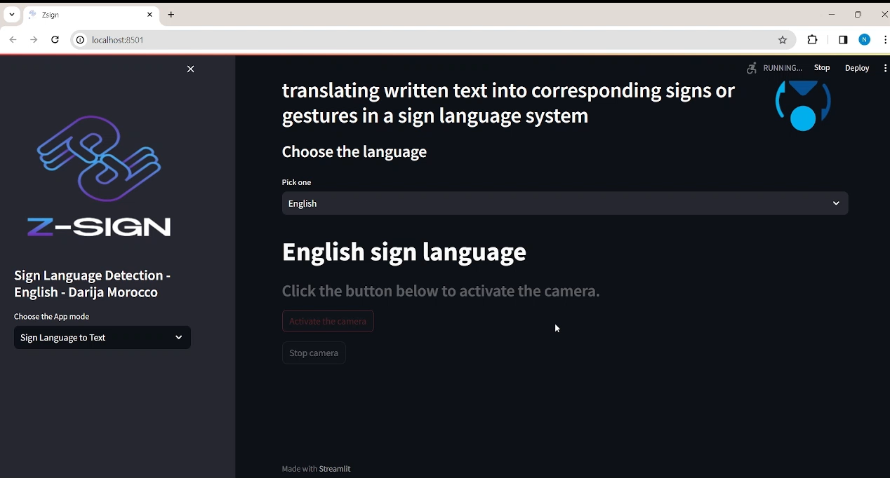

# 🤟 Sign Language Recognition

**Z-SIGN** is a web application designed to facilitate communication between deaf and hearing individuals using Artificial Intelligence and Computer Vision.

The project aims to make communication more accessible by translating sign language into text and converting written or spoken content into sign language.

## ✨ Key Features

- **Sign-to-Text:** Recognize hand gestures and translate signs into text.
- **Text-to-Sign:** Convert written text into sign language.
- **Speech-to-Sign:** Convert spoken language into sign language.
- **Video-to-Text:** Analyze videos and recognize sign language gestures.

## 🔄 Project Workflow

The project was developed through the following steps:

1. **Data Collection:** Collecting sign language images and videos.
2. **Data Preparation:** Organizing and preparing the collected data.
3. **Model Development:** Building neural network models for sign recognition.
4. **Model Training:** Training models using the collected dataset.
5. **Web Application:** Developing an interactive web application.
6. **Deployment & Demo:** Testing and demonstrating the application.

## 📊 Dataset

The collected dataset includes:

- **1,400 images** representing letters.
- **10,000 samples** representing words.

The dataset was used to support the development and training of the sign language recognition models.

## 🛠️ Technologies Used

- **Python** – Main programming language
- **TensorFlow** – Deep Learning framework
- **Computer Vision** – Hand gesture recognition
- **Streamlit** – Web application
- **Jupyter Notebook** – Model development and experimentation
- **Git & GitHub** – Version control

## 🖥️ Application Screenshots

Add screenshots of the web application here.

## 🎯 Project Goal

To improve accessibility and facilitate communication between deaf and hearing individuals through AI-powered sign language recognition and translation.

---

**Project:** Z-SIGN – Sign Language Detection Web App  
**Domain:** Artificial Intelligence | Deep Learning | Computer Vision
